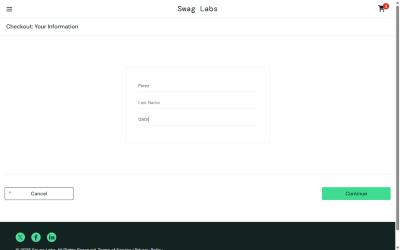
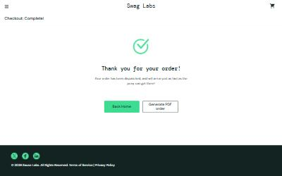
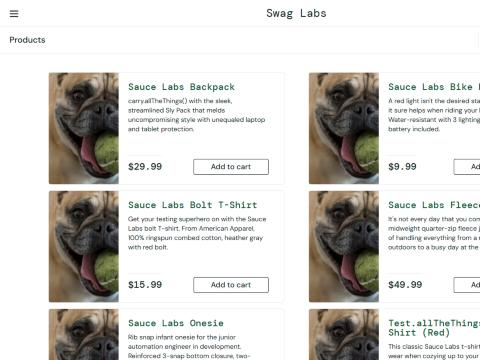

# Exploratory Session: Sauce Demo

| | |
| --- | --- |
| App | Sauce Demo (Swag Labs), https://www.saucedemo.com |
| Environment | Production public demo |
| Date | 2026-10-21 |
| Duration | About 40 minutes |
| Browser | Chrome 152 (Claude desktop built-in browser, Windows 10) |
| Viewports | 1280x800 desktop, 375x812 mobile |
| Accounts | Public demo accounts from the login page |
| Charter | Areas the automated suite does not cover: special test users, product details, side menu, checkout gaps from the [traceability matrix](../traceability.md), mobile layout |

## Summary

**18 bugs: 2 Highest, 7 High, 5 Medium, 4 Low.** The happy path for `standard_user` is solid, and the automated suite covers it well, but 7 bugs affect every user: an empty cart can be "dispatched" as a $0.00 order, one user's cart leaks to the next after logout, pressing Enter on the checkout form throws the customer back to the cart, and client-side errors are never reported because error tracking is misconfigured. The special test users (`problem_user`, `error_user`, `visual_user`, `performance_glitch_user`) show the faults Sauce Demo seeds on purpose. Each was compared with how `standard_user` behaves (in a control run or in the automated suite) to rule out a testing mistake before it was logged.

## Coverage

| Area | Result |
| --- | --- |
| Login as each of the 6 demo users | Tested; slow login for performance_glitch_user (BUG-18) |
| Product list: images, prices, sorting, add/remove | Tested per user; BUG-10, 11, 12, 15, 16, 17 |
| Product details links | Tested; BUG-09 |
| Cart persistence across logout | Tested; BUG-02 |
| Side menu: All Items, About, Logout, Reset App State | Tested; BUG-05. About links to saucelabs.com as expected |
| Checkout: whitespace input, Enter key, empty cart, both Cancel paths, tax math | Tested; BUG-01, 03, 04. Cancel paths work (TC-012, TC-013 pass). Tax is 8%, confirmed by hand ($47.97 + $3.84 = $51.81) |
| Checkout per persona | Tested; BUG-08, 13, 14 |
| Console and network on key pages | Tested; BUG-06, 07 |
| Mobile 375 px layout | Tested; no overflow or horizontal scroll (see UX observations) |
| Dynamic Catalog (lazy load, spinner, slider pages) | **Not tested**: new practice pages, suggested as the next charter |
| Generate PDF order | **Not tested**: it downloads a file, which needs separate approval |
| locked_out_user beyond login, session expiry, keyboard-only full flow | **Not tested**: out of time box |

## Bugs

Sorted by priority. Each block pastes straight into a Jira description; the same bugs are in [`jira-import.csv`](jira-import.csv) for bulk import.

### BUG-08 · Highest · [Checkout][problem_user] Typing in Last Name overwrites First Name; checkout blocked

```
Summary: [Checkout][problem_user] Typing in Last Name overwrites First Name; checkout blocked
Issue Type: Bug
Priority: Highest
Components: Checkout
Labels: exploratory, qa-session, problem_user
Environment: Prod (public demo) | Chrome 152 (Claude desktop built-in browser, Windows 10) | 1280x800 | https://www.saucedemo.com

Description:
h3. Steps to Reproduce
# Log in as problem_user / secret_sauce
# Add any product and open the cart
# Click Checkout
# Click First Name and type "Ana"
# Click Last Name and type "Perez"
# Type "0801" in Zip/Postal Code and click Continue

h3. Expected Result
First Name = Ana, Last Name = Perez; the Overview page opens.

h3. Actual Result
First Name changes to "Perez" and Last Name stays empty. Continue shows "Error: Last Name is required", so checkout can never be completed.

h3. Reproducibility
Always (2 of 2, real keyboard input)

h3. Additional Info
* Screenshot: screenshots/BUG-08-last-name-overwrites-first-name.jpg
```



### BUG-13 · Highest · [Checkout][error_user] Finish throws a TypeError and the order is never placed

```
Summary: [Checkout][error_user] Finish throws a TypeError and the order is never placed
Issue Type: Bug
Priority: Highest
Components: Checkout
Labels: exploratory, qa-session, error_user
Environment: Prod (public demo) | Chrome 152 (Claude desktop built-in browser, Windows 10) | 1280x800 | https://www.saucedemo.com

Description:
h3. Steps to Reproduce
# Log in as error_user / secret_sauce
# Add Sauce Labs Backpack, open the cart, click Checkout
# Fill in the details and click Continue
# Click Finish on the Overview page

h3. Expected Result
The order completes and "Thank you for your order!" is shown.

h3. Actual Result
Nothing happens; the page stays on /checkout-step-two.html.

h3. Reproducibility
Always (2 of 2, including a real mouse click)

h3. Additional Info
* Console error: {code}Uncaught TypeError: wa.cesetRart is not a function at onClick (index-DnLqFcJI.js:573){code}
```

### BUG-01 · High · [Checkout] An empty cart can be checked out and is confirmed as a $0.00 order

```
Summary: [Checkout] An empty cart can be checked out and is confirmed as a $0.00 order
Issue Type: Bug
Priority: High
Components: Checkout
Labels: exploratory, qa-session, standard_user
Environment: Prod (public demo) | Chrome 152 (Claude desktop built-in browser, Windows 10) | 1280x800 | https://www.saucedemo.com

Description:
h3. Steps to Reproduce
# Log in as standard_user / secret_sauce
# Make sure the cart is empty and open it
# Click Checkout
# Enter Ana / Perez / 0801 and click Continue
# Click Finish

h3. Expected Result
Checkout is unavailable with an empty cart, or a message says the cart is empty.

h3. Actual Result
Overview shows no items and "Total: $0.00"; Finish shows "Thank you for your order! Your order has been dispatched".

h3. Reproducibility
Reproduced 1 of 1 (not retried)

h3. Additional Info
* Traceability: confirms gap TC-016
* Screenshot: screenshots/BUG-01-empty-order-dispatched.jpg
```



### BUG-02 · High · [Cart] Cart contents carry over to the next user after logout

```
Summary: [Cart] Cart contents carry over to the next user after logout
Issue Type: Bug
Priority: High
Components: Cart
Labels: exploratory, qa-session, standard_user
Environment: Prod (public demo) | Chrome 152 (Claude desktop built-in browser, Windows 10) | 1280x800 | https://www.saucedemo.com

Description:
h3. Steps to Reproduce
# Log in as problem_user and add Backpack, Bike Light and Onesie
# Open the menu and click Logout
# Log in as standard_user on the same browser

h3. Expected Result
standard_user starts with an empty cart; logout clears the previous user's cart.

h3. Actual Result
standard_user's cart badge shows 3 with the previous user's items. The cart stays in localStorage (cart-contents = [4,0,2]) after logout.

h3. Reproducibility
Reproduced 1 of 1 (not retried)

h3. Additional Info
* On a shared device one customer sees, and could buy, another customer's cart.
* The automated suite cannot catch this because every test starts in a fresh browser context.
```

### BUG-09 · High · [Product details][problem_user] Product links open the wrong product

```
Summary: [Product details][problem_user] Product links open the wrong product
Issue Type: Bug
Priority: High
Components: Product details
Labels: exploratory, qa-session, problem_user
Environment: Prod (public demo) | Chrome 152 (Claude desktop built-in browser, Windows 10) | 1280x800 | https://www.saucedemo.com

Description:
h3. Steps to Reproduce
# Log in as problem_user / secret_sauce
# Click the name of each product on the product list

h3. Expected Result
Each link opens that product's details page.

h3. Actual Result
Each link opens the next product (Backpack opens Fleece Jacket, Bike Light opens Bolt T-Shirt, and so on). Fleece Jacket opens id=6 and shows "ITEM NOT FOUND".

h3. Reproducibility
Always (all 6 products, 2 runs)
```

### BUG-10 · High · [Cart][problem_user] Add to cart fails for 3 products and Remove does nothing

```
Summary: [Cart][problem_user] Add to cart fails for 3 products and Remove does nothing
Issue Type: Bug
Priority: High
Components: Cart
Labels: exploratory, qa-session, problem_user
Environment: Prod (public demo) | Chrome 152 (Claude desktop built-in browser, Windows 10) | 1280x800 | https://www.saucedemo.com

Description:
h3. Steps to Reproduce
# Log in as problem_user / secret_sauce
# Click Add to cart on all six products
# Click Remove on the products that were added

h3. Expected Result
All six products are added; Remove takes them out again.

h3. Actual Result
Bolt T-Shirt, Fleece Jacket and Test.allTheThings() T-Shirt stay on "Add to cart" and are never added. Remove leaves the other three in the cart (badge stays 3).

h3. Reproducibility
Always (2 of 2, real mouse clicks)
```

### BUG-14 · High · [Checkout][error_user] Last Name rejects input, but checkout continues with it empty

```
Summary: [Checkout][error_user] Last Name rejects input, but checkout continues with it empty
Issue Type: Bug
Priority: High
Components: Checkout
Labels: exploratory, qa-session, error_user
Environment: Prod (public demo) | Chrome 152 (Claude desktop built-in browser, Windows 10) | 1280x800 | https://www.saucedemo.com

Description:
h3. Steps to Reproduce
# Log in as error_user / secret_sauce
# Add a product and go to Checkout
# Enter Ana / Perez / 0801 and click Continue

h3. Expected Result
Last Name keeps "Perez"; if it were empty, "Last Name is required" would block the step.

h3. Actual Result
Last Name stays empty, and Continue still opens the Overview, so required-field validation is skipped.

h3. Reproducibility
Reproduced 1 of 1 (scripted input)

h3. Additional Info
* Console error: {code}Uncaught TypeError: Cannot read properties of undefined (reading 'value') at onChange (index-DnLqFcJI.js:573){code}
```

### BUG-15 · High · [Cart][error_user] Add/Remove fails for some products with uncaught errors

```
Summary: [Cart][error_user] Add/Remove fails for some products with uncaught errors
Issue Type: Bug
Priority: High
Components: Cart
Labels: exploratory, qa-session, error_user
Environment: Prod (public demo) | Chrome 152 (Claude desktop built-in browser, Windows 10) | 1280x800 | https://www.saucedemo.com

Description:
h3. Steps to Reproduce
# Log in as error_user / secret_sauce
# Click Add to cart on all six products
# Click Remove on the added products

h3. Expected Result
All products can be added and removed.

h3. Actual Result
Same 3 products cannot be added; Remove fails on the others.

h3. Reproducibility
Reproduced 1 of 1 (scripted clicks)

h3. Additional Info
* Console error (x3): {code}Uncaught Error: Failed to remove item from cart.{code}
* Related: BUG-06 means these errors are never reported to error tracking.
```

### BUG-16 · High · [Pricing][visual_user] Product list shows random prices that differ from the price charged

```
Summary: [Pricing][visual_user] Product list shows random prices that differ from the price charged
Issue Type: Bug
Priority: High
Components: Pricing
Labels: exploratory, qa-session, visual_user
Environment: Prod (public demo) | Chrome 152 (Claude desktop built-in browser, Windows 10) | 1280x800 | https://www.saucedemo.com

Description:
h3. Steps to Reproduce
# Log in as visual_user / secret_sauce
# Note the Sauce Labs Onesie price on the product list
# Reload the page and note it again
# Add the Onesie and go through checkout to the Overview

h3. Expected Result
The list shows $7.99, the same price charged at checkout.

h3. Actual Result
The list showed $31.77, then $13.67 after reload (all six prices change on every load). Cart and Overview charge $7.99 (total $8.63).

h3. Reproducibility
Always (2 of 2 loads)

h3. Additional Info
* A customer sees one price and is charged another.
```

### BUG-03 · Medium · [Checkout] Pressing Enter on Your Information goes back to the cart and clears the form

```
Summary: [Checkout] Pressing Enter on Your Information goes back to the cart and clears the form
Issue Type: Bug
Priority: Medium
Components: Checkout
Labels: exploratory, qa-session, standard_user
Environment: Prod (public demo) | Chrome 152 (Claude desktop built-in browser, Windows 10) | 1280x800 | https://www.saucedemo.com

Description:
h3. Steps to Reproduce
# Log in as standard_user and add a product
# Open the cart and click Checkout
# Enter Ana / Perez / 0801
# Press Enter in the Zip/Postal Code field

h3. Expected Result
Enter submits the form, like clicking Continue.

h3. Actual Result
The cart page opens and the entered details are lost.

h3. Reproducibility
Always (2 of 2, real keyboard input)

h3. Additional Info
* Root cause: the Cancel button has no type attribute, so it defaults to type="submit". It comes before Continue in the form, so implicit submission activates Cancel.
* Fix: add type="button" to the Cancel button.
* Hits keyboard users hardest, since Enter is how they submit forms.
```

### BUG-04 · Medium · [Checkout] Whitespace-only name and postal code are accepted

```
Summary: [Checkout] Whitespace-only name and postal code are accepted
Issue Type: Bug
Priority: Medium
Components: Checkout
Labels: exploratory, qa-session, standard_user
Environment: Prod (public demo) | Chrome 152 (Claude desktop built-in browser, Windows 10) | 1280x800 | https://www.saucedemo.com

Description:
h3. Steps to Reproduce
# Log in as standard_user and add a product
# Open the cart and click Checkout
# Type three spaces in each field
# Click Continue

h3. Expected Result
An error asks for real values, as with empty fields.

h3. Actual Result
The Overview page opens; the order can be placed with blank-looking details.

h3. Reproducibility
Reproduced 1 of 1 (real keyboard input)

h3. Additional Info
* Traceability: confirms gap TC-009
```

### BUG-06 · Medium · [Platform] Error tracking misconfigured: reports use placeholder universe and token

```
Summary: [Platform] Error tracking misconfigured: reports use placeholder universe and token
Issue Type: Bug
Priority: Medium
Components: Platform
Labels: exploratory, qa-session, all-users
Environment: Prod (public demo) | Chrome 152 (Claude desktop built-in browser, Windows 10) | 1280x800 | https://www.saucedemo.com

Description:
h3. Steps to Reproduce
# Log in as any user
# Open DevTools > Console and Network
# Use the site normally

h3. Expected Result
Client errors are sent to Backtrace and accepted.

h3. Actual Result
Requests go to events.backtrace.io/...?universe=UNIVERSE&token=TOKEN (401 Unauthorized) and submit.backtrace.io/UNIVERSE/TOKEN/json (blocked by CORS). Real JavaScript errors (see BUG-13, BUG-14, BUG-15) are never reported.

h3. Reproducibility
Always (every page, every user tried)
```

### BUG-11 · Medium · [Inventory][problem_user] Sorting does not change the product order

```
Summary: [Inventory][problem_user] Sorting does not change the product order
Issue Type: Bug
Priority: Medium
Components: Inventory
Labels: exploratory, qa-session, problem_user
Environment: Prod (public demo) | Chrome 152 (Claude desktop built-in browser, Windows 10) | 1280x800 | https://www.saucedemo.com

Description:
h3. Steps to Reproduce
# Log in as problem_user / secret_sauce
# Choose Name (Z to A), then Price (low to high), in the sort menu

h3. Expected Result
Products reorder and the menu shows the chosen option.

h3. Actual Result
Order stays A to Z and the menu snaps back to "Name (A to Z)".

h3. Reproducibility
Always (2 of 2); control run with standard_user using the same input sorted correctly
```

### BUG-18 · Medium · [Login][performance_glitch_user] Login takes about 5 seconds

```
Summary: [Login][performance_glitch_user] Login takes about 5 seconds
Issue Type: Bug
Priority: Medium
Components: Login
Labels: exploratory, qa-session, performance_glitch_user
Environment: Prod (public demo) | Chrome 152 (Claude desktop built-in browser, Windows 10) | 1280x800 | https://www.saucedemo.com

Description:
h3. Steps to Reproduce
# Open https://www.saucedemo.com
# Log in as performance_glitch_user / secret_sauce
# Time until the product list renders

h3. Expected Result
Login completes in well under 1 second, like standard_user (61 ms).

h3. Actual Result
5,002 ms and 5,004 ms on two attempts. Add to cart and product details were not slow.

h3. Reproducibility
Always (2 of 2)
```

### BUG-05 · Low · [Inventory] Reset App State leaves Remove buttons until the page is reloaded

```
Summary: [Inventory] Reset App State leaves Remove buttons until the page is reloaded
Issue Type: Bug
Priority: Low
Components: Inventory
Labels: exploratory, qa-session, standard_user
Environment: Prod (public demo) | Chrome 152 (Claude desktop built-in browser, Windows 10) | 1280x800 | https://www.saucedemo.com

Description:
h3. Steps to Reproduce
# Log in as standard_user
# Add Backpack and Bike Light
# Open the menu and click Reset App State

h3. Expected Result
Cart empties and both buttons change back to "Add to cart".

h3. Actual Result
Cart badge and storage clear, but both buttons still say "Remove" until a reload.

h3. Reproducibility
Reproduced 1 of 1
```

### BUG-07 · Low · [Platform] Every deep link returns HTTP 404 before a client-side redirect

```
Summary: [Platform] Every deep link returns HTTP 404 before a client-side redirect
Issue Type: Bug
Priority: Low
Components: Platform
Labels: exploratory, qa-session, all-users
Environment: Prod (public demo) | Chrome 152 (Claude desktop built-in browser, Windows 10) | 1280x800 | https://www.saucedemo.com

Description:
h3. Steps to Reproduce
# Request https://www.saucedemo.com/inventory.html directly (new tab, curl, or link preview)

h3. Expected Result
HTTP 200 with the app.

h3. Actual Result
HTTP 404 with the page title "Single Page Apps for GitHub Pages"; a script then redirects into the app. Same for /cart.html, /checkout-step-one.html and /inventory-item.html.

h3. Reproducibility
Always (4 of 4 URLs)

h3. Additional Info
* Users still reach the page, but uptime monitors, crawlers and link previews see 404s.
```

### BUG-12 · Low · [Inventory][problem_user] Every product shows the same placeholder image

```
Summary: [Inventory][problem_user] Every product shows the same placeholder image
Issue Type: Bug
Priority: Low
Components: Inventory
Labels: exploratory, qa-session, problem_user
Environment: Prod (public demo) | Chrome 152 (Claude desktop built-in browser, Windows 10) | 1280x800 | https://www.saucedemo.com

Description:
h3. Steps to Reproduce
# Log in as problem_user / secret_sauce
# View the product list

h3. Expected Result
Each product shows its own photo.

h3. Actual Result
All six products use /assets/sl-404-Cq1a9k9X.jpg (a dog photo). Alt text is still the product name, so screen readers describe a photo that isn't shown.

h3. Reproducibility
Always

h3. Additional Info
* Screenshot: screenshots/BUG-12-placeholder-product-images.jpg
```



### BUG-17 · Low · [Inventory][visual_user] Backpack image is wrong and the last button is misaligned

```
Summary: [Inventory][visual_user] Backpack image is wrong and the last button is misaligned
Issue Type: Bug
Priority: Low
Components: Inventory
Labels: exploratory, qa-session, visual_user
Environment: Prod (public demo) | Chrome 152 (Claude desktop built-in browser, Windows 10) | 1280x800 | https://www.saucedemo.com

Description:
h3. Steps to Reproduce
# Log in as visual_user / secret_sauce
# View the product list

h3. Expected Result
Correct images; all Add to cart buttons line up.

h3. Actual Result
Backpack shows the placeholder image. The Test.allTheThings() T-Shirt button has class btn_inventory_misaligned and sits 54 px right of the others.

h3. Reproducibility
Reproduced 1 of 1
```

## UX observations

- **Mobile product list:** a large gap between each description and its price pushes the price and Add to cart below the fold, so only one product fits per screen at 375 px.
- **Mobile sort control:** shows only a funnel icon with no visible label. It has an accessible name, but sighted users get no hint of what it sorts by.
- **Checkout errors:** messages are clear and name the missing field, but only the first missing field is reported at a time.
- **Product images and alt text (problem_user):** alt text stays correct while the image is wrong, which hides the problem from screen-reader users.

## Questions for the team

1. Are the persona bugs (problem_user, error_user, visual_user, performance_glitch_user) all intentional training faults? If so, should they be documented on the login page so they are not reported as real bugs?
2. Should logout clear the cart, or is a per-browser cart intended? (BUG-02)
3. Is the Backtrace integration meant to be live? If not, should it be removed so it stops filling the console with errors? (BUG-06)

## Suggested next charters

1. **Dynamic Catalog pages:** lazy loading, spinners and sliders, with a focus on the waits an automation suite would need.
2. **Keyboard-only purchase:** Tab order, focus visibility and Enter/Space on every control (BUG-03 suggests more issues here).
3. **Generate PDF order:** content and totals in the downloaded file, for each user.
4. **Automate the confirmed gaps:** BUG-01, BUG-02, BUG-03 and BUG-04 as `test.fail()` defect tests, like the API suite's known defects.
